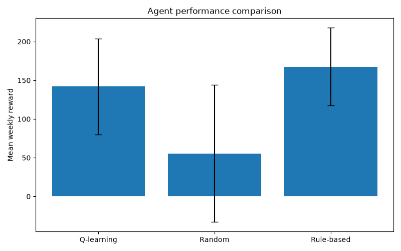

# wheat-bran-planner
AI &amp; Machine Learning course project
# Wheat Mill – Reinforcement Learning

*A Q-learning implementation for wheat bran production and inventory management in a simulated wheat mill.*
## TL;DR HOW TO RUN
1. Clone the repository
2. Check and adjust parameters
3. Run main.py
4. Press enter when prompted
5. Enjoy and have a nice day!


---

## Table of Contents

- [1. Scenario and Motivation](#1-scenario-and-motivation)
- [2. Modelling the Environment](#2-modelling-the-environment)
  - [2.1 States](#21-states)
  - [2.2 Actions](#22-actions)
  - [2.3 Rewards](#23-rewards)
  - [2.4 Environment and Uncertainty](#24-environment-and-uncertainty)
- [3. Q-Learning Implementation](#3-q-learning-implementation)
  - [3.1 Agent Architecture](#31-agent-architecture)
  - [3.2 Learning Algorithm](#32-learning-algorithm)
- [4. Evaluation and Results](#4-evaluation-and-results)
  - [4.1 Experimental Setup](#41-experimental-setup)
  - [4.2 Learning Progress](#42-learning-progress)
  - [4.3 Agent Comparison](#43-agent-comparison)
  - [4.4 Learned Policy](#44-learned-policy)
- [5. Limitations and Discussion](#5-limitations-and-discussion)
- [6. Conclusion](#6-conclusion)
- [7. Installation and Usage](#7-installation-and-usage)
- [8. Project Structure](#8-project-structure)

---

## 1. Scenario and Motivation

### 1.1 The Problem
The trigger for this project was the AI & Machine Learning course I took during my Bachelor studies at Arctic University of Norway
in autumn 2026. This is the first graded assignment where we had to create, train and assess a Q-learning agent. 
The problem I chose for this assignment came from a very real and very constant frustration I experienced plenty of times
while working at Norway's largest wheat mill - how to get rid of wheat bran, a byproduct of wheat flour, in the best possible way.
The environment is modelled quite similarly to the real world mill - the deliveries usually only happen during regular working hours,
the storage capacity is just ever so barely enough to contain a full weekend's production, storage running full stops all production
which is a disaster of unforeseen proportions, but ring the alarm bells too hard and suddenly you won't have enough stock to deliver
to the loyal, exemplary customers who placed their orders a long time ago and whose production depends on your delivery.

---

## 2. Modelling the Environment
The environment for this project is, for a number of reasons, a much simplified version of reality. Nonetheless, the whole thing ended
up being far more complex than expected or necessary. The volume unit for tracking stock is half a truck load, corresponding to roughly 15 real-life tons. The amount of incoming customer orders is randomized according to a realistic probability table, and so is production rate. Whatever expected production the customers don't pre-order still needs to somehow leave the facility, so we have the power to make offload orders. The learning agent keeps not one, not two, but three Q-tables. One episode lasts one week. The absolute worst case scenario is if the tanks go full, but we also really don't like it when delivery drivers turn up and we have no stock to load to them. There is also a somewhat nasty invalid action penalty that punishes choosing a long-term action when there's not enough time left for it to materialise, or a short term action when there's no urgent problem for it to solve.

### 2.1 Rewards

| Event / behaviour | Reward | Description |
|---|---:|---|
| Fulfilled pre-order | +10 per half-load | Reward for delivering a customer pre-order. |
| Fulfilled response order | +3 per half-load | Reward for delivering an agent-planned overflow order. |
| Unfulfilled order | -15 per half-load | Penalty for failing to deliver an order due to insufficient stock. |
| Tank overflow | -30 | Penalty when production causes the tank to exceed its capacity. |
| Remaining weekend stock | -2 per half-load | Penalty for each half-load remaining in the tank at the end of the working week. |
| Successful long-notice change | -2 | Cost of planning an additional order or cancelling a later order. |
| Successful emergency change | -5 | Cost of an emergency dispatch or cancellation of an imminent order. |
| Invalid action | -10 | Penalty when an attempted action cannot be carried out. |
| No intervention | 0 | No direct reward or penalty for taking no action. |

### 2.2 Randomisation
As mentioned earlier, there are several randomised events in this environment. Firstly, production can vary a lot and is completely unpredictable. In real life there is the possibility to consult planned stops and the production plan, if one is diligent enough to do that. In this environment we have no such privilege. There are three production cycles in a day, and the mill is usually expected to produce roughly two half-loads per production cycle. However, suddenly all of the mills may be producing fine flours resulting in increased wheat bran output, or problems may pop up, stopping production entirely.

| Production/cycle | Probability |
|---:|---:|
| 0 | 15% |
| 1 | 10% |
| 2 | 30% |
| 3 | 40% |
| 4 | 5% |

Additionally, there's no entity powerful enough to even try to predict when and how much wheat bran customers may want to order. Most customers will want to load their trucks full, but not all of them. 

<table>
<tr>
<td valign="top">

**Order amount**

| Orders per workday | Probability |
|---:|---:|
| 0 | 10% |
| 1 | 25% |
| 2 | 35% |
| 3 | 24% |
| 4 | 1% |

</td>
<td valign="top">

**Order size**

| Size (half-loads) | Probability |
|---:|---:|
| 1 | 5% |
| 2 | 95% |

</td>
</tr>
</table>

    
## 3. Q-learning implementation

### 3.1 First Q-table: the weekly planner
In the beginning, we generate pre-orders from customers. Then, whatever capacity that we're expected to produce but that has not been ordered needs to be sent off somewhere. To do that, we consider the current capacity and the order distribution, and make the first decision - planning the week's offload orders. This constitutes the first Q-table that uses sample-return updating, gathering rewards throughout the week and learning at the end of the week. The weekly planner's strategy is divided into two parts - how much production it expects throughout the week in three tiers, and how it wants to distribute the offload orders throughout the week in five patterns.
In reality, this happens at the end of the old week, and I've modelled it accordingly - this happens before the weekend's production, so the model has precious little useful information to work with here. 

| State variable | Possible values | Description |
|---|---|---|
| Stock level | Empty (0), Low (1), Normal (2), High (3), Full (4) | Current tank stock, categorised into five levels. |
| Order distribution | Early (0), Convex (1), Balanced (2), Concave (3), Late (4) | Expected distribution of customer pre-orders across the five working days, classified into five predefined patterns. |

### 3.2. Second Q-table - the running decisions
Now we've come to the second, biggest and most important q-table that actually uses the GAMMA parameter and bootstrapping to consider future decisions. It is now Monday morning, the weekend has produced, and now we have to manage the chaos somehow. Decisions are made twice a day throughout the week, with the last one occurring on friday morning. The spacing of the decisions is also realistic - one as we come to work, and one before we go home. One third of the day's production and about half (randomised) of dispatches happen during the workday. Two thirds of production and the remaining dispatches happen after the second decision of the day. 
For this decision, we consider the current stock, imminent orders (today's and tomorrow's of all kinds) and time remaining until the end of the week. Based on that, we have the options to do nothing, add or cancel an order at least two days ahead, or add or cancel one of today's or tomorrow's orders. The latter, of course, is somewhat costly - nobody likes a short notice.

| State variable | Possible values | Description |
|---|---|---|
| Stock level | Empty (0), Low (1), Normal (2), High (3), Full (4) | Current tank stock, categorised into five levels. |
| Imminent orders | 0 (0), 1–4 (1), 5–8 (2), 9–12 (3), 13–16 (4), 17+ (5) | Total volume of orders expected in the immediate future, grouped into six ranges. |
| Time remaining | 0–9 | Number of remaining decision steps in the working week. |

### 3.3 Third Q-table - the end-of-week desperation
As we approach the weekend, we reach a place where it would be smart to not have all that much capacity left in the tanks - after all, we need to make space for the weekend's production. This is where the last decision of the week kicks in - do we order emergency emptying, and if so, how many? We can order as many as 4 truckloads, which I could only dream of in the real world - nobody wants to drive during the weekend. Nonetheless, we'd much rather not order any. To make the everyday q-table aware of that challenge, it bootstraps from the weekend Q-table on its last step. The weekend Q-table is simple as that - it considers the stock level and decides how many emergency loads to dispatch. What makes it exciting, however, is its learning implementation - it's the last decision of the episode, but the most important consequences come with the weekend production early in the next episode. Thus, I've made it use the agent's class variables to remember what it did before the weekend and learn from it once the consequences have rolled in. Therefore, this table too uses the sample-return updating style. 

| State variable | Possible values | Description |
|---|---|---|
| Stock level | Empty (0), Low (1), Normal (2), High (3), Full (4) | Current tank stock at the end of the working week, categorised into five levels. |


### 3.4 Agent Architecture

Three different agents are implemented to provide a comparison between learned, random and manually defined strategies.

**Q-learning agent**

The learning agent maintains three Q-tables, each responsible for a different decision horizon, as described in the previous sections. It gradually improves its decisions through trial and error, using the rewards received from the environment as feedback.

**Random agent**

The random agent selects uniformly random actions from the available action space. It has no memory, strategy or learning mechanism. Its purpose is to provide a baseline against which the other agents can be compared.

**Rule-based agent**

The rule-based agent follows a set of manually defined heuristics based on stock levels, order volume and time remaining. For example, it prioritises emergency dispatches when stock is critically high and considers cancelling orders when stock is low and demand is high. Its purpose is to represent a simple but sensible strategy that does not require training.

All three agents interact with the `WheatMill` environment and make decisions at the same three stages of an episode. The main difference is how they select their actions.

### 3.5 Learning Algorithm

The Q-learning agent uses three different update methods, adapted to the decision horizons of the individual Q-tables. All updates use the same learning rate, $\alpha = 0.2$.

**Weekly planner – sample-return update**

The weekly planner makes one decision at the beginning of each episode. Its Q-value is updated towards the accumulated reward received throughout the episode:

$$
Q(s,a) \leftarrow Q(s,a) +
\alpha\left(G-Q(s,a)\right)
$$

where $G$ is the total accumulated reward from the weekly decisions, including the final weekend dispatch.

No discount factor is applied to this return.

**Daily decisions – temporal-difference learning**

The daily decision table uses the standard Q-learning update:

$$
Q(s,a) \leftarrow Q(s,a) +
\alpha\left[
r+\gamma\max_{a'}Q(s',a')-Q(s,a)
\right]
$$

where $r$ is the immediate reward, $s'$ is the resulting state and $\gamma = 0.5$ is the discount factor.

During the working week, the agent bootstraps from its own estimated future action values. On the final decision step, it instead bootstraps from the weekend Q-table:

$$
\max_{a'} Q(s',a')
=
\begin{cases}
\max_{a'} Q_{\text{running}}(s',a'),
& \text{during the week} \\[6pt]
\max_{a'} Q_{\text{final}}(s'_{\text{stock}},a'),
& \text{at the end of the week}
\end{cases}
$$

This connects the two decision horizons, allowing daily decisions to account for the consequences of the subsequent weekend decision.

**Weekend decisions – delayed sample-return update**

The weekend table uses a sample-return update, but with a slight complication: the consequences of the weekend dispatch decision are not fully realised until production takes place during the following weekend.

The agent therefore stores the previous weekend state, action and accumulated reward in class variables. At the beginning of the next episode, after weekend production has taken place, the previous decision can finally be updated:

$$
G_{\text{weekend}} =
r_{\text{dispatch}} +
r_{\text{weekend production}}
$$

$$
Q(s,a) \leftarrow Q(s,a) +
\alpha\left(G_{\text{weekend}}-Q(s,a)\right)
$$

This allows the weekend table to learn from both the immediate consequences of its dispatch decision and the subsequent production.

**Exploration and epsilon decay**

Action selection follows an epsilon-greedy policy. With probability $\epsilon$, the agent chooses a random action. Otherwise, it selects an action with the highest estimated Q-value:

$$
a =
\begin{cases}
\text{random action}, & \text{with probability } \epsilon \\[4pt]
\displaystyle\arg\max_{a'}Q(s,a'), & \text{otherwise}
\end{cases}
$$

To encourage exploration early in training while favouring exploitation later, epsilon is gradually reduced from its initial value to a minimum value, both of which are set in parameters.The decay multiplier is calculated from the total number of training episodes:

$$
d =
\left(
\frac{\epsilon_{\min}}{\epsilon_{\text{start}}}
\right)^{1/N}
$$

The value is updated after each episode:

$$
\epsilon_{k+1} =
\max\left(
\epsilon_{\min},
\epsilon_k \cdot d
\right)
$$

where $N$ is the total number of training episodes.
During evaluation, exploration is disabled and the agent follows a greedy policy, selecting the action with the highest estimated Q-value.


## 4. Evaluation and Results

### 4.1 Experimental Setup

**Compared agents:**
- Q-learning
- Random
- Rule-based

### 4.2 Learning Progress


*Figure 1: Epsilon decay during training.*

### 4.3 Agent Comparison

#### Mean Reward



*Figure 2: Comparison of agent performance.*

#### Evaluation Metrics

| Metric | Q-learning | Random | Rule-based |
|---|---:|---:|---:|
| Mean reward | | | |
| Standard deviation | | | |
| Emergency dispatches / week | | | |
| Cancellations / week | | | |
| Tank-full events / 100 weeks | | | |
| Failed dispatches / week | | | |

### 4.4 Learned Policy

---

## 5. Limitations and Discussion

### 5.1 Simplifications

### 5.2 Limitations of the Learning Approach

### 5.3 Potential Improvements

---

## 6. Conclusion

---

## 7. Installation and Usage

### 7.1 Requirements

Python 3.x and the packages listed in `requirements.txt`.

Install dependencies:

```bash
pip install -r requirements.txt
```

### 7.2 Running the Simulation

```bash
python main.py
```

### 7.3 Reproducibility

Describe how random seeds and configuration parameters are used to reproduce the experiments.

---

## 8. Project Structure

```text
WheatMill/
│
├── agent.py
├── wheatmill.py
├── parameters.py
├── interpreters.py
├── main.py
├── requirements.txt
├── README.md
│
└── results/
    ├── epsilonplot.png
    └── agent_comparison*.png
```

---

*Project developed as part of [Course name / Assignment].*