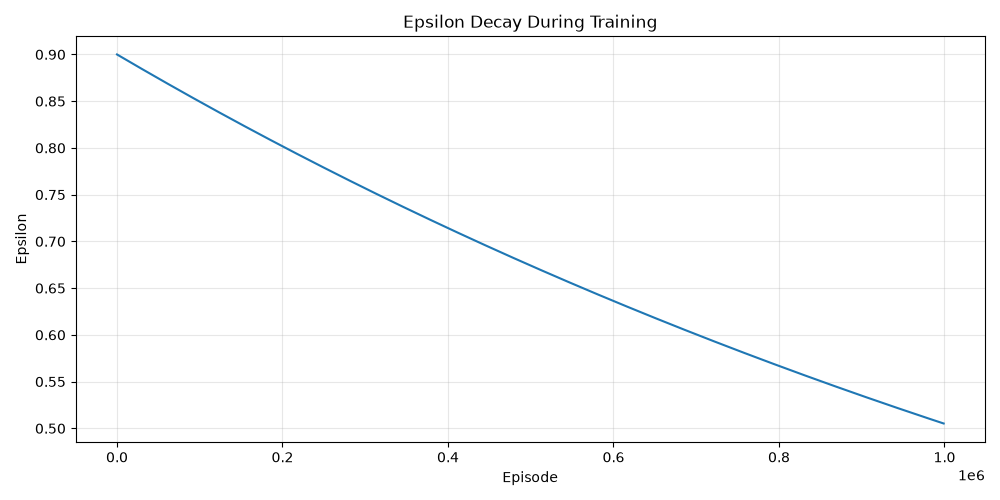
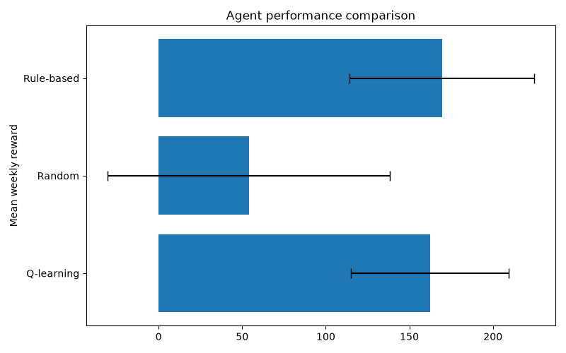

# Wheat Mill – Reinforcement Learning

*A Q-learning implementation for wheat bran production and inventory management in a simulated wheat mill.*
## TL;DR HOW TO RUN
1. Clone the repository
2. Install requirements - numpy, pandas and matplotlib
3. Check and adjust parameters to your heart's content
4. Run main.py
5. Enjoy and have a nice day!


## AI Use Disclaimer

ChatGPT was used as an assistant throughout this project, mainly in order to speed up actions that would have taken a long time to to manually. I prioritised my own resources on parts of the project that are most relevant for the scope of the course this project was written for. Thus, agent.py is entirely hand-written, and so is the vast majority of wheatmill.py. In main.py, the training function and main function itself are hand-written. Interpreters.py that is used for interpreting and displaying training and evaluation results is largely AI-written and only adjusted by hand. 

---

## Table of Contents

- [1. Scenario and Motivation](#1-scenario-and-motivation)
- [2. Modelling the Environment](#2-modelling-the-environment)
  - [2.1 Rewards](#21-rewards)
  - [2.2 Randomisation](#22-randomisation)
- [3. Q-learning Implementation](#3-Q-learning-implementation)
  - [3.1 First Q-table: the weekly planner](#31-first-Q-table-the-weekly-planner)
  - [3.2 Second Q-table: the running decisions](#32-second-Q-table---the-running-decisions)
  - [3.3 Third Q-table: the end-of-week desperation](#33-third-Q-table---the-end-of-week-desperation)
  - [3.4 Agent Architecture](#34-agent-architecture)
    - [3.4.1 Q-learning agent](#341-Q-learning-agent)
    - [3.4.2 Random agent](#342-random-agent)
    - [3.4.3 Rule-based agent](#343-rule-based-agent)
  - [3.5 Learning Algorithm](#35-learning-algorithm)
    - [3.5.1 Weekly planner – sample-return update](#351-weekly-planner--sample-return-update)
    - [3.5.2 Daily decisions – temporal-difference learning](#352-daily-decisions--temporal-difference-learning)
    - [3.5.3 Weekend decisions – delayed sample-return update](#353-weekend-decisions--delayed-sample-return-update)
    - [3.5.4 Exploration and epsilon decay](#354-exploration-and-epsilon-decay)
- [4. Evaluation and Results](#4-evaluation-and-results)
  - [4.1 Experimental Setup](#41-experimental-setup)
  - [4.2 Learning Progress](#42-learning-progress)
  - [4.3 Agent Comparison](#43-agent-comparison)
    - [4.3.1 Mean Reward](#431-mean-reward)
    - [4.3.2 Other Evaluation Metrics](#432-other-evaluation-metrics)
  - [4.4 Learned Policy](#44-learned-policy)
    - [4.4.1 The order distribution hypothesis for week planner](#441-the-order-distribution-hypothesis-for-week-planner)
    - [4.4.2 Comparison of two high-risk operating conditions in the daily Q table](#442-comparison-of-two-high-risk-operating-conditions-in-the-daily-Q-table)
    - [4.4.3 End of the week hypothesis](#443-end-of-the-week-hypothesis)
- [5. Limitations and Discussion](#5-limitations-and-discussion)
  - [5.1 Simplification of the real-world scenario](#51-simplification-of-the-real-world-scenario)
  - [5.2 State and Action Space Limitations](#52-state-and-action-space-limitations)
  - [5.3 Limitations of the Learning Approach](#53-limitations-of-the-learning-approach)
  - [5.4 Evaluation Limitations](#54-evaluation-limitations)
- [6. Conclusion](#6-conclusion)
- [7. Reproducibility](#7-reproducibility)
- [8. Project Structure](#8-project-structure)


---

## 1. Scenario and Motivation

### 1.1 The Problem
The trigger for this project was the AI & Machine Learning course I took during my Bachelor studies at Arctic University of Norway
in autumn 2026. This is the first graded assignment where we had to create, train and assess a Q-learning agent. 
The problem I chose for this assignment came from a very real and very constant frustration I experienced plenty of times
while working at Norway's largest wheat mill - how to get rid of wheat bran, a byproduct of wheat flour, in the best possible way.
The environment is modelled quite similarly to the real world mill - the deliveries usually only happen during regular working hours,
the storage capacity is just ever so barely enough to contain a full weekend's production, storage running full stops all production
which is a disaster of unforeseen proportions, but ring the alarm bells too hard and suddenly you won't have enough stock to deliver
to the loyal, exemplary customers who placed their orders a long time ago and whose production depends on your delivery.

---

## 2. Modelling the Environment
The environment for this project is, for a number of reasons, a much simplified version of reality. Nonetheless, the whole thing ended
up being far more complex than expected or necessary. The volume unit for tracking stock is half a truck load, corresponding to roughly 15 real-life tons. The amount of incoming customer orders is randomized according to a realistic probability table, and so is production rate. Whatever expected production the customers don't pre-order still needs to somehow leave the facility, so we have the power to make offload orders. The learning agent keeps not one, not two, but three Q-tables. One episode lasts one week. The absolute worst case scenario is if the tanks go full, but we also really don't like it when delivery drivers turn up and we have no stock to load to them. There is also a somewhat nasty invalid action penalty that punishes choosing a long-term action when there's not enough time left for it to materialise, or a short term action when there's no urgent problem for it to solve.

### 2.1 Rewards

| Event / behaviour | Reward | Description |
|---|---:|---|
| Fulfilled pre-order | +10 per half-load | Reward for delivering a customer pre-order. |
| Fulfilled response order | +3 per half-load | Reward for delivering an agent-planned overflow order. |
| Unfulfilled order | -15 per half-load | Penalty for failing to deliver an order due to insufficient stock. |
| Tank overflow | -30 | Penalty when production causes the tank to exceed its capacity. |
| Remaining weekend stock | -2 per half-load | Penalty for each half-load remaining in the tank at the end of the working week. |
| Successful long-notice change | -2 | Cost of planning an additional order or cancelling a later order. |
| Successful emergency change | -5 | Cost of an emergency dispatch or cancellation of an imminent order. |
| Invalid action | -10 | Penalty when an attempted action cannot be carried out. |
| No intervention | 0 | No direct reward or penalty for taking no action. |

### 2.2 Randomisation
As mentioned earlier, there are several randomised events in this environment. Firstly, production can vary a lot and is completely unpredictable. In real life there is the possibility to consult planned stops and the production plan, if one is diligent enough to do that. In this environment we have no such privilege. There are three production cycles in a day, and the mill is usually expected to produce roughly two half-loads per production cycle. However, suddenly all of the mills may be producing fine flours resulting in increased wheat bran output, or problems may pop up, stopping production entirely.

| Production/cycle | Probability |
|---:|---:|
| 0 | 15% |
| 1 | 10% |
| 2 | 30% |
| 3 | 40% |
| 4 | 5% |

Additionally, there's no entity powerful enough to even try to predict when and how much wheat bran customers may want to order. Most customers will want to load their trucks full, but not all of them. 

<table>
<tr>
<td valign="top">

**Order amount**

| Orders per workday | Probability |
|---:|---:|
| 0 | 10% |
| 1 | 25% |
| 2 | 35% |
| 3 | 24% |
| 4 | 1% |

</td>
<td valign="top">

**Order size**

| Size (half-loads) | Probability |
|---:|---:|
| 1 | 5% |
| 2 | 95% |

</td>
</tr>
</table>

    
## 3. Q-learning implementation

### 3.1 First Q-table: the weekly planner
In the beginning, we generate pre-orders from customers. Then, whatever capacity that we're expected to produce but that has not been ordered needs to be sent off somewhere. To do that, we consider the current capacity and the order distribution, and make the first decision - planning the week's offload orders. This constitutes the first Q-table that uses sample-return updating, gathering rewards throughout the week and learning at the end of the week. The weekly planner's strategy is divided into two parts - how much production it expects throughout the week in three tiers, and how it wants to distribute the offload orders throughout the week in five patterns.
In reality, this happens at the end of the old week, and I've modelled it accordingly - this happens before the weekend's production, so the model has precious little useful information to work with here. 

| State variable | Possible values | Description |
|---|---|---|
| Stock level | Empty (0), Low (1), Normal (2), High (3), Full (4) | Current tank stock, categorised into five levels. |
| Order distribution | Early (0), Convex (1), Balanced (2), Concave (3), Late (4) | Expected distribution of customer pre-orders across the five working days, classified into five predefined patterns. |

### 3.2. Second Q-table - the running decisions
Now we've come to the second, biggest and most important Q-table that actually uses the GAMMA parameter and bootstrapping to consider future decisions. It is now Monday morning, the weekend has produced, and now we have to manage the chaos somehow. Decisions are made twice a day throughout the week, with the last one occurring on Friday morning. The spacing of the decisions is also realistic - one as we come to work, and one before we go home. One third of the day's production and about half (randomised) of dispatches happen during the workday. Two thirds of production and the remaining dispatches happen after the second decision of the day. 
For this decision, we consider the current stock, imminent orders (today's and tomorrow's of all kinds) and time remaining until the end of the week. Based on that, we have the options to do nothing, add or cancel an order at least two days ahead, or add or cancel one of today's or tomorrow's orders. The latter, of course, is somewhat costly - nobody likes a short notice.

| State variable | Possible values | Description |
|---|---|---|
| Stock level | Empty (0), Low (1), Normal (2), High (3), Full (4) | Current tank stock, categorised into five levels. |
| Imminent orders | 0 (0), 1–4 (1), 5–8 (2), 9–12 (3), 13–16 (4), 17+ (5) | Total volume of orders expected in the immediate future, grouped into six ranges. |
| Time remaining | 0–9 | Number of remaining decision steps in the working week. |

### 3.3 Third Q-table - the end-of-week desperation
As we approach the weekend, we reach a place where it would be smart to not have all that much capacity left in the tanks - after all, we need to make space for the weekend's production. This is where the last decision of the week kicks in - do we order emergency emptying, and if so, how many? We can order as many as 4 truckloads, which I could only dream of in the real world - nobody wants to drive during the weekend. Nonetheless, we'd much rather not order any. To make the everyday Q-table aware of that challenge, it bootstraps from the weekend Q-table on its last step. The weekend Q-table is simple as that - it considers the stock level and decides how many emergency loads to dispatch. What makes it exciting, however, is its learning implementation - it's the last decision of the episode, but the most important consequences come with the weekend production early in the next episode. Thus, I've made it use the agent's class variables to remember what it did before the weekend and learn from it once the consequences have rolled in. Therefore, this table too uses the sample-return updating style. 

| State variable | Possible values | Description |
|---|---|---|
| Stock level | Empty (0), Low (1), Normal (2), High (3), Full (4) | Current tank stock at the end of the working week, categorised into five levels. |


### 3.4 Agent Architecture

Three different agents are implemented to provide a comparison between learned, random and manually defined strategies. The Q-learning agent was implemented first, and the other two were later branched and simplified from it.

#### 3.4.1. Q-learning agent
The learning agent maintains three Q-tables, each responsible for a different decision horizon, as described in the previous sections. It gradually improves its decisions through trial and error, using the rewards received from the environment as feedback.

#### 3.4.2. Random agent
The random agent selects uniformly random actions from the available action space. It has no memory, strategy or learning mechanism. Its purpose is to provide a baseline against which the other agents can be compared.

#### 3.4.3. Rule-based agent
The rule-based agent follows a set of manually defined heuristics based on stock levels, order volume and time remaining. For example, it prioritises emergency dispatches when stock is critically high and considers cancelling orders when stock is low and demand is high. Its purpose is to represent a simple but sensible strategy that does not require training.

All three agents interact with the `WheatMill` environment and make decisions at the same three stages of an episode. The main difference is how they select their actions.

### 3.5 Learning Algorithm

The Q-learning agent uses three different update methods, adapted to the decision horizons of the individual Q-tables. All updates use the same learning rate, $\alpha = 0.2$.

#### 3.5.1. Weekly planner – sample-return update
The weekly planner makes one decision at the beginning of each episode. Its Q-value is updated towards the accumulated reward received throughout the episode:

$$
Q(s,a) \leftarrow Q(s,a) +
\alpha\left(G-Q(s,a)\right)
$$

where $G$ is the total accumulated reward from the weekly decisions, including the final weekend dispatch. No discount factor is applied to this return.

#### 3.5.2 Daily decisions – temporal-difference learning
The daily decision table uses the standard Q-learning update:

$$
Q(s,a) \leftarrow Q(s,a) +
\alpha\left[
r+\gamma\max_{a'}Q(s',a')-Q(s,a)
\right]
$$

where $r$ is the immediate reward, $s'$ is the resulting state and $\gamma = 0.5$ is the discount factor. During the working week, the agent bootstraps from its own estimated future action values. On the final decision step, it instead bootstraps from the weekend Q-table:

$$
\max_{a'} Q(s',a')
=
\left\{
\begin{array}{ll}
\max_{a'} Q_{\text{running}}(s',a'),
& \text{during the week} \\[6pt]
\max_{a'} Q_{\text{final}}(s'_{\text{stock}},a'),
& \text{at the end of the week}
\end{array}
\right.
$$

This connects the two decision horizons, allowing daily decisions to account for the consequences of the subsequent weekend decision.

#### 3.5.3 Weekend decisions – delayed sample-return update

The weekend table uses a sample-return update, but with a slight complication: the consequences of the weekend dispatch decision are not fully realised until production takes place during the following weekend. The agent therefore stores the previous weekend state, action and accumulated reward in class variables. At the beginning of the next episode, after weekend production has taken place, the previous decision can finally be updated:

$$
G_{\text{weekend}} =
r_{\text{dispatch}} +
r_{\text{weekend production}}
$$

$$
Q(s,a) \leftarrow Q(s,a) +
\alpha\left(G_{\text{weekend}}-Q(s,a)\right)
$$

This allows the weekend table to learn from both the immediate consequences of its dispatch decision and the subsequent production.

#### 3.5.4 Exploration and epsilon decay
Action selection follows an epsilon-greedy policy. With probability $\epsilon$, the agent chooses a random action. Otherwise, it selects an action with the highest estimated Q-value:

$$
a =
\begin{cases}
\text{random action}, & \text{with probability } \epsilon \\
\arg\max_{a'} Q(s,a'), & \text{otherwise}
\end{cases}
$$

To encourage exploration early in training while favouring exploitation later, epsilon is gradually reduced from its initial value to a minimum value, both of which are set in parameters. The decay multiplier is calculated from the total number of training episodes:

$$
d =
\left(
\frac{\epsilon_{\min}}{\epsilon_{\text{start}}}
\right)^{1/N}
$$

The value is updated after each episode:

$$
\epsilon_{k+1} =
\max\left(
\epsilon_{\min},
\epsilon_k \cdot d
\right)
$$

where $N$ is the total number of training episodes.
During evaluation, exploration is disabled and the agent follows a greedy policy, selecting the action with the highest estimated Q-value.


## 4. Evaluation and Results

### 4.1 Experimental Setup
The Q-learning agent is compared against a random agent and a manually designed rule-based agent. In this version it is trained for 50 million episodes - far more than strictly necessary for representative outcomes - , after which exploration is disabled.

    At this point, I also feel it highly necessary to point out that the program audibly lets you know once it's done training. Currently only tested on MacOS.
    
Evaluation consists of five runs of 500 episodes per agent, using predefined seeds and separate environment instances with identical initial conditions.
Performance is assessed using the following metrics:

1. Mean reward: Overall performance according to the reward function.
2. Standard deviation: Variation in episode rewards.
3. Emergency dispatches and cancellations: Measures how frequently agents intervene and incur operational costs.
4. Tank-full events: Measures how often production is interrupted due to insufficient storage capacity.
5. Failed dispatches: Measures how often customer orders cannot be fulfilled due to insufficient stock.

These metrics were chosen for their real life relevance and importance, and they provide a much broader picture of performance than accumulated reward alone.

### 4.2 Learning Progress



*Figure 1: Epsilon decay during training.*

Epsilon starts at 0.9 and is reduced by a constant multiplicative decay factor after each training episode. The factor is calculated based on the total number of episodes, so epsilon reaches its minimum value of 0.05 by the end of training. This gives the agent a neat curve of change from exploration to exploitation. Different epsilon decay curves have not been tested, but considering the sheer amount of edge cases, the decision was made to keep the algorithm at least somewhat open-minded the entire way.

### 4.3 Agent Comparison

This summary is written based on a training cycle of 50 million episodes, which took approximately 50 minutes to execute on a cute little 2024 MacBook Air. The findings are not significantly different from any average run of 1-5 million episodes - the most significant difference running that many training episodes makes is leaving relatively few empty Q-table slots; fuller Q-tables are more pleasant to look at. Additionally, one can be quite certain that the values in the more common cases reflect the reality of the environment the agent operates in. 

#### 4.3.1 Mean Reward



*Figure 2: Comparison of agent performance.*

This graph compares the agents based on just one of the several metrics - the mean of one whole episode's accumulated rewards. When focusing on this metric alone, it consistently seems like the rule-based model comes out on top. However, when including the other metrics as we soon will, the results look quite different. That means that the rewards and penalties in the current implementation is not optimal for the reality of the situations the agent is meant to handle. This is worth some further experimentation.

#### 4.3.2 Other Evaluation Metrics

| Metric | Q-learning | Random | Rule-based |
|---|---:|---:|---:|
| Mean reward | 161.55 | 52.36 | 168.11 |
| Average standard deviation | 52.37 | 84.57 | 55.39 |
| Emergency dispatches / week | 1.98 | 2.58 | 1.14 |
| Cancellations / week | 2.80 | 3.04 | 0.23 |
| Tank-full events / 100 weeks | 25.92 | 52.36 | 39.56 |
| Failed dispatches / week | 1.01 | 1.99 | 1.24 |

This table shows the averages of all the used evaluation metrics across 5 evaluation runs of 500 episodes each. Although the rule-based algorithm consistently earns higher rewards than the Q-learning one, the most important real-world metrics, the tank-full events and failed dispatches, are less frequent with the Q-learning algorithm. Especially tank-full events, which are the worst case scenario, are roughly a third less than with rule-based decisions, which I would consider a better outcome than the small negative difference in reward. The general pattern seems to be that the Q-learning agent is more likely to take action, including drastic action, and thus accrue higher "operating costs" that eat from its final reward. That strategy seems to pay off in avoiding very expensive undesirable outcomes. This is despite the somewhat low gamma value; experiments with a higher gamma value could potentially yield very different results.


### 4.4 Learned Policy

#### 4.4.1 The order distribution hypothesis for week planner

The rule-based agent operates under the assumption that, given a concave distribution of orders, the best course of action is to plan orders in a convex pattern, heavy early-week  pre-orders imply a late-week planning pattern as the best response, and so on. This hypothesis is somewhat true when we observe the values in the week planner Q-table; more so for convex and concave patterns. The pattern weakens as the tank state gets fuller, both because the fuller tank state is much less frequent in the beginning of the week, and because overfull tanks and emergency dispatching penalties tend to overshadow any possible rewards, muddying the results of the decisions.

**Q-values for a normal weekly outlook**
Each cell represents the estimated value of choosing a particular timing strategy, given the starting stock level and expected order distribution. 🟢 indicates the highest-valued strategy and 🟡 the second highest.

| Starting stock | Expected order distribution | Balanced | Early | Late | Convex | Concave |
|---|---|---:|---:|---:|---:|---:|
| **Empty** | Early | 111.13 | 115.46 🟡 | 🟢 118.53 | 111.66 | 111.95 |
| | Convex | 101.43 | 115.03 🟡 | 109.22 | 102.66 | 🟢 115.73 |
| | Balanced | 128.73 | 128.76 🟡 | 🟢 133.49 | 129.97 | 130.95 |
| | Concave | 125.90 🟡 | 🟢 175.66 | 62.97 | 114.37 | 123.07 |
| | Late | 100.73 | 93.07 | 55.97 | 109.58 🟡 | 🟢 109.86 |
| **Low** | Early | 114.20 🟡 | 108.52 | 109.72 | 96.62 | 🟢 118.56 |
| | Convex | 108.35 | 113.47 🟡 | 91.82 | 108.97 | 🟢 116.21 |
| | Balanced | 136.02 | 136.45 🟡 | 132.43 | 🟢 142.95 | 109.53 |
| | Concave | 125.99 🟡 | 116.16 | 108.99 | 108.93 | 🟢 133.25 |
| | Late | 🟢 110.28 | 109.23 🟡 | 52.82 | 70.26 | 94.56 |
| **Normal** | Early | 100.89 | 100.25 | 88.89 | 🟢 112.68 | 99.77 |
| | Convex | 99.35 | 82.47 | 108.74 🟡 | 🟢 109.09 | 100.40 |
| | Balanced | 122.52 🟡 | 117.50 | 119.59 | 107.41 | 🟢 138.26 |
| | Concave | 120.79 🟡 | 119.47 | 101.07 | 97.81 | 🟢 121.14 |
| | Late | 96.35 🟡 | 🟢 144.97 | 43.56 | 67.21 | 104.46 |
| **High** | Early | 118.55 | 🟢 126.50 | 119.89 🟡 | 122.26 | 121.25 |
| | Convex | 🟢 120.76 | 93.03 | 107.08 🟡 | 95.62 | 117.21 |
| | Balanced | 136.03 🟡 | 153.71 | 131.98 | 🟢 156.36 | 143.69 |
| | Concave | 🟢 113.56 | 105.24 🟡 | 74.95 | 106.48 | 99.96 |
| | Late | 83.20 | 96.44 | 30.65 | 102.62 🟡 | 🟢 118.44 |
| **Full** | Early | 85.77 | 82.13 🟡 | 62.09 | 71.96 | 🟢 154.70 |
| | Convex | 91.90 🟡 | 84.13 | 104.95 | 69.99 | 🟢 108.87 |
| | Balanced | 133.56 | 🟢 149.98 | 145.58 🟡 | 141.07 | 124.67 |
| | Concave | 🟢 141.12 | 126.91 🟡 | 82.51 | 91.04 | 121.12 |
| | Late | 81.49 | 🟢 133.31 | 70.46 | 108.68 🟡 | 75.62 |

#### 4.4.2 Comparison of two high-risk operating conditions in the daily Q table

There are many interesting patterns to find and possible conclusions to draw from the big daily Q table. It's not possible to fail an episode in this simulation, but it is possible to end up in pitfalls where large negative penalties keep accumulating unless the agent consistently takes the correct, intended action. This snapshot highlights it quite well - in situations of low stock and high demand, cancelling an imminent order is by far the best action. The same can be observed in the other edge - with full stock and no demand, the agent's best decision is to emergency dispatch. 

| Action | Low stock + 17+ orders | Full stock + 0 orders |
|---|---:|---:|
| Do nothing | -36.48 | -47.14 |
| Plan ahead | -59.74 | -56.35 |
| Cancel later order | -51.95 | -52.10 |
| Emergency dispatch | -62.47 | -36.15 |
| Cancel imminent order | **-1.58** | **-57.41** |
---

#### 4.4.3 End of the week hypothesis

The weekend planner was made under the assumption that the more stock is left over at the end of the week, the more we'll want to emergency dispatch. However, based on what the agent has learned, that is only true up to a certain point. If the stock is full at the end of the week, even dispatching 4 truck-loads will seemingly not be enough to prevent weekend production overloading the tanks, so, having reached such a situation, the agent seemingly prefers to "give up" and do nothing. It makes sense in the current implementation, but this calls for further experimentation - what will this table look like if we allow the agent to dispatch more than "just" 4 trucks? That would take the model further away from the real world though - remember, no one really wants to drive wheat bran on a Friday evening. 

| Stock level | 0 dispatches | 1 dispatch | 2 dispatches | 3 dispatches | 4 dispatches |
|---|---:|---:|---:|---:|---:|
| Empty | 🟢 **-1.36** | -22.56 | -29.09 | -40.59 | -43.96 |
| Low | -32.18 | 🟢 **-13.09** | -28.36 | -32.76 | -37.28 |
| Normal | -34.10 | -40.42 | -32.42 | 🟢 **-27.95** | -38.90 |
| High | -53.00 | -54.47 | -55.26 | -54.66 | 🟢 **-38.05** |
| Full | 🟢 **-58.50** | -59.22 | -60.10 | -61.59 | -60.40 |


## 5. Limitations and Discussion

### 5.1 Simplification of the real-world scenario
Despite being a reasonably complex implementation for one's first ever q learning agent for a school project, the model considerably simplifies the equivalent real world situation. This paragraph serves almost as a count of variables that were considered for implementation at some point, but scrapped due to complexity or potentially snowballing Q-table sizes. As mentioned before, although production levels and stops in real life also hold a certain degree of unpredictability and randomness, there is usually some degree of foresight available in the form of production plans, maintenance plans and other planned stops. This model also assumes that dispatches happen uniformly, a situation which is rather far removed from reality. A somewhat realistic degree of randomness - orders being picked up early, late or not at all, and surprise pick ups that no one ordered - was implemented in an earlier version, but was scrapped in order to avoid throwing the agents too far off. The real world consequences of full tanks are, from a mill's point of view, considerably more dire than failing to deliver an order or two - the latter results in embarrassment and potentially a bill or two, while the former means a full stop in production, which can snowball into not having flour to deliver to the flour customers. That in turn can mean no bun under your Grandiosa, no waffle in your Kvikk Lunsj, no croissant with your morning coffee from your favourite bakery, and no birthday cake for your kid. 

### 5.2 State and Action Space Limitations

The state and action spaces are heavily simplified. Stock levels and imminent orders are grouped into categories, meaning that different real-world situations can appear identical to the agent. It also has a limited selection of predefined actions and cannot freely adjust dispatch quantities or invent new strategies. This keeps the Q-tables manageable, but naturally limits the agent's flexibility.

The mid-week decider only sees the demand of the next couple of days when choosing its actions, despite having access to actions that affect the orders beyond. This is a considerable limitation as it will consequently never truly know what a long term action actually implies. However, this was a necessary evil to keep an already large Q-table within manageable boundaries; even the imminent orders are already heavily simplified and divided into tiers for the same reason. 

Splitting the decision-making into three separate Q-tables makes the problem easier to handle, but also means that the agent has no unified representation of the entire week. The tables communicate through rewards and bootstrapping, but cannot account for every possible interaction between decisions. 

### 5.3 Limitations of the Learning Approach

Even after 50 million episodes, some state-action combinations remain poorly represented or unexplored. The large state space makes certain combinations considerably less likely to occur.
The learning parameters were also selected without extensive experimentation. Different learning rates, discount factors and epsilon decay strategies could produce different policies. Furthermore, the agent optimises the reward structure I have defined, which does not necessarily reflect real-world priorities perfectly. The comparison with the rule-based agent demonstrates this quite well: higher accumulated reward does not automatically mean better operational outcomes.

### 5.4 Evaluation Limitations

The evaluation consists of one training run and five evaluation runs of 500 episodes each. This provides a useful indication of performance, but does not tell us how much results might vary between independently trained agents.
The comparison is also limited by the baselines themselves. The random agent is deliberately unintelligent, while the rule-based agent represents just one manually designed strategy. A different set of rules could potentially produce better results.
Finally, the evaluation metrics only cover selected operational outcomes. The results should therefore be understood as a comparison within this particular simulation, rather than evidence that one approach would necessarily perform better in a real wheat mill.

---

## 6. Conclusion

This project turned out to be a considerably more involved exercise than I initially expected, but it gave me a much better understanding of both Q-learning and the challenges of applying it to a real-world-inspired problem.

The Q-learning agent managed to learn a reasonably effective strategy, performing considerably better than the random baseline. However, it did not quite outperform the rule-based agent in terms of mean reward. It did produce fewer full-tank events and failed dispatches than the rule-based approach, suggesting that it prioritises some operational concerns differently.

Ultimately, the results demonstrate that Q-learning can produce useful decision-making strategies, but that its performance depends heavily on how the problem is modelled and what the reward function encourages. The agent is not necessarily making the best decisions for a real wheat mill, but it has learned to navigate the particular set of challenges I gave it. And that, in itself, is a decent starting point.

---

## 7. Reproducibility

The project uses fixed random seeds to make the experiments repeatable. The environment and agents each have their own random number generators, with default seeds defined in parameters.py. Evaluation seeds are generated from a fixed environment seed, ensuring that the same set of test seeds is used each time the experiment is run.

Each agent is evaluated in a separate environment instance, initialised with the same seed. This ensures that all three agents face the same initial conditions and random environment setup within each evaluation run.

All relevant simulation and learning parameters are collected in parameters.py, while requirements.txt lists the required Python packages. Together, these measures make it possible to recreate the experiments under the same conditions, provided the same code, configuration and dependencies are used.

---

## 8. Project Structure

```text
WheatMill/
│
├── agent.py
├── wheatmill.py
├── parameters.py
├── interpreters.py
├── main.py
├── requirements.txt
├── README.md
│
└── results/
    ├── epsilonplot.png
    └── agent_comparison*.png
```

---

*Project developed as part of [Introduction to AI & Machine Learning Course / Arctic University of Norway / Autumn 2026].*